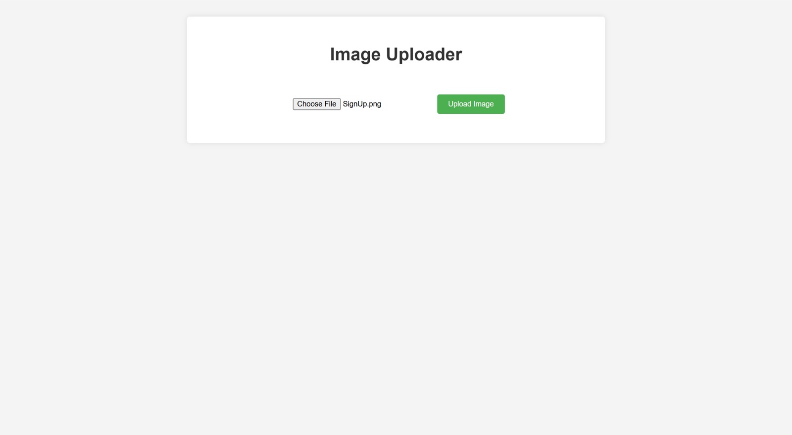

<div align="center">

# ☁️ Upload Image to Google Drive

A full-stack app that uploads images to Google Drive, built with Spring Boot and React.

<a href="https://github.com/miladmo68/upload-Image-To-Google-Drive"></a>
<a href="https://miladweb.com"></a>

</div>

<p align="center">
  
</p>

## ✨ Features

- Image upload from a React frontend
- Google Drive API integration
- Spring Boot backend

## 🛠️ Tech Stack

    

> [!NOTE]
> This project needs its own backend, database or API keys, so it runs locally rather than as a static demo.

## 🚀 Getting Started

**Prerequisites:** [Node.js](https://nodejs.org/) 18 or newer · Java 17+ (the Maven wrapper is included)

**Clone**

```bash
git clone https://github.com/miladmo68/upload-Image-To-Google-Drive.git
cd upload-Image-To-Google-Drive
```

**Backend (backend)**

```bash
cd backend
./mvnw spring-boot:run
```

**frontend**

```bash
cd frontend
npm install
npm run dev
```

## 📡 API Endpoints

| Method | Path |
| --- | --- |
| `POST` | `/uploadToGoogleDrive` |

## 📁 Project Structure

```
upload-Image-To-Google-Drive/
├── backend/
└── frontend/
```

## 👤 Author

**Milad Mohammadi** — Frontend-Focused Full-Stack Developer, Toronto 🇨🇦

[](https://miladweb.com)
[](https://www.linkedin.com/in/miladmo68/)
[](https://github.com/miladmo68)

<p align="center"><sub>If you like this project, consider giving it a ⭐</sub></p>
